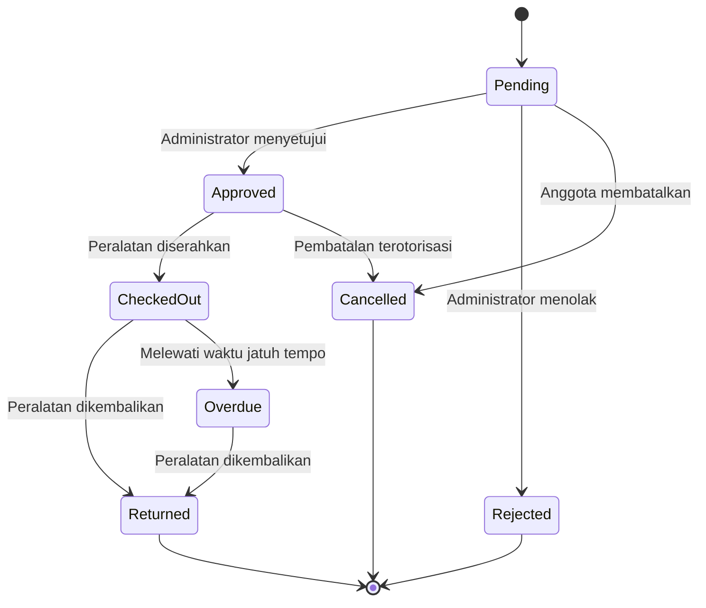
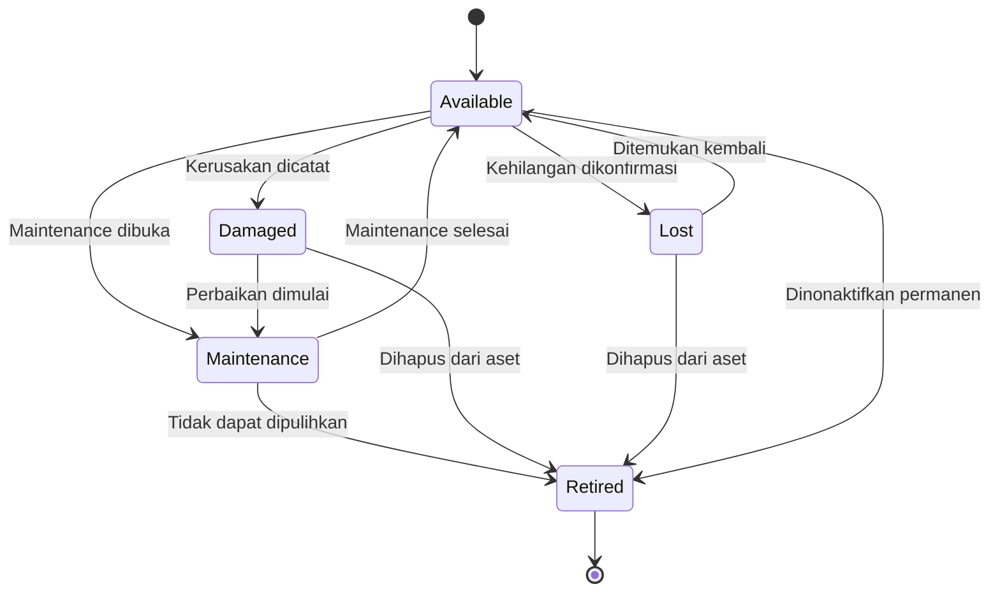
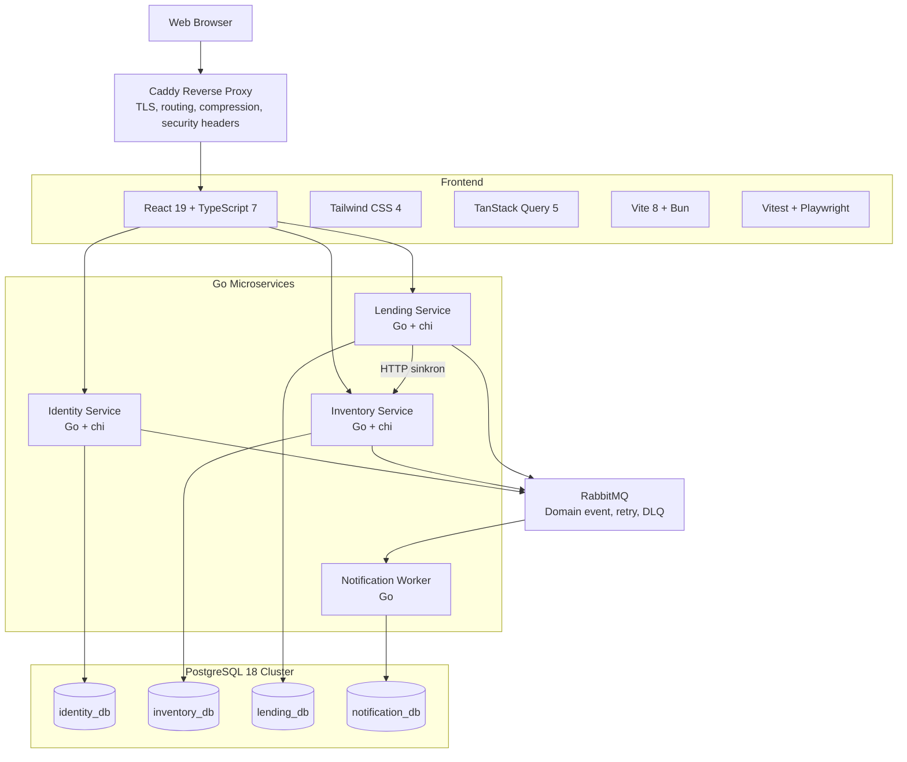
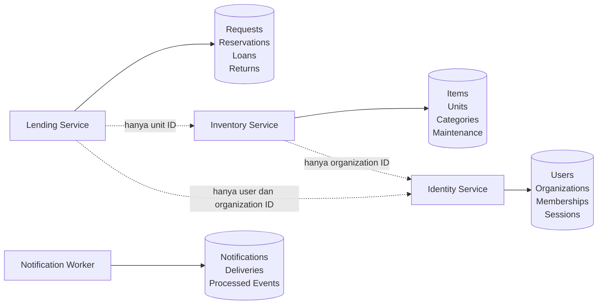
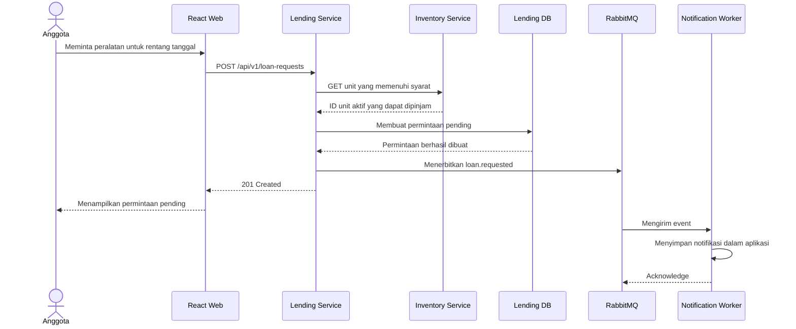
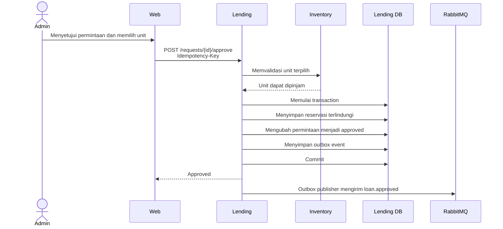
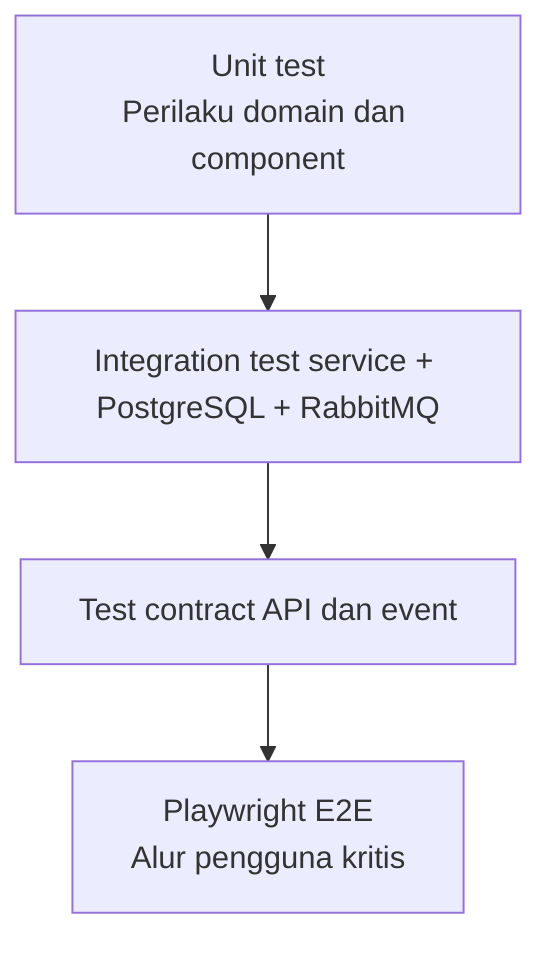
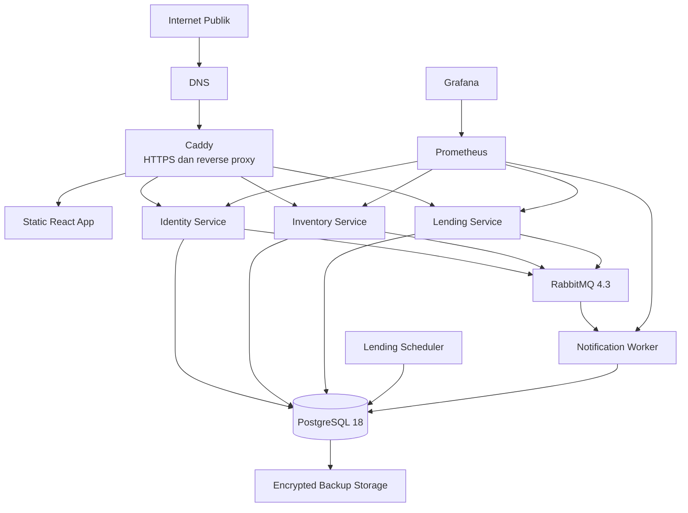
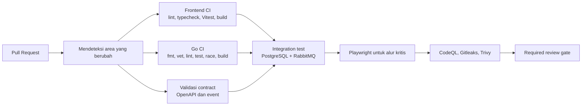

# BorrowHub Product Requirements Document

> **Judul :** BorrowHub  
> **Status dokumen:** Draf v0.1  
> **Terakhir diperbarui:** 27 Juli 2026  
> **Tujuan utama:** Membangun aplikasi web peminjaman peralatan yang bersifat publik dan open source, cukup kecil untuk dipahami, tetapi cukup mendalam untuk mempelajari microservices praktis, kolaborasi frontend, pengujian, deployment, dan operasi produksi.

---

## 1. Ringkasan Eksekutif

BorrowHub adalah aplikasi web multi-tenant untuk organisasi yang meminjamkan peralatan kepada anggotanya. Pengguna yang dituju antara lain organisasi mahasiswa, laboratorium kampus, komunitas fotografi, coworking space, panitia acara, perpustakaan, tempat ibadah, dan organisasi nirlaba kecil.

Sistem ini menggantikan spreadsheet, percakapan chat, dan catatan kertas dengan alur peminjaman yang terstruktur:

1. Organisasi mendaftar dan membuat workspace.
2. Administrator menambahkan jenis peralatan beserta setiap unit fisiknya.
3. Anggota melihat peralatan yang tersedia dan mengajukan peminjaman untuk rentang tanggal tertentu.
4. Administrator menyetujui atau menolak permintaan.
5. Peralatan diserahkan menggunakan kode singkat atau QR code.
6. Peralatan dikembalikan dan kondisinya dicatat.
7. Sistem menyimpan riwayat, keterlambatan, dan notifikasi.

BorrowHub dapat diakses publik melalui web dan terbuka bagi contributor eksternal. Arsitekturnya sengaja memakai sedikit service dengan tanggung jawab yang jelas:

- Identity Service
- Inventory Service
- Lending Service
- Notification Worker

Service berkomunikasi secara sinkron melalui HTTP API berversi dan secara asinkron melalui event RabbitMQ. Setiap service memiliki datanya sendiri. Pada tahap awal aplikasi dijalankan pada satu VPS menggunakan Docker Compose dan Caddy, bukan Kubernetes.

---

## 2. Visi Produk

### 2.1 Pernyataan visi

Membuat proses peminjaman peralatan menjadi sederhana, dapat ditelusuri, dan aman bagi organisasi kecil, sekaligus menyediakan codebase yang dapat dipahami dan ditingkatkan oleh contributor.

### 2.2 Prinsip produk

1. **Berguna sebelum kompleks**  
   Setiap komponen teknis harus menyelesaikan masalah produk atau operasional yang nyata.

2. **Tidak ada double booking yang tidak terlihat**  
   Sistem harus memperlakukan reservasi yang saling tumpang tindih sebagai masalah konsistensi data yang serius.

3. **Service yang dapat dipahami**  
   Setiap service harus memiliki tanggung jawab, kepemilikan database, dan perilaku ketika gagal yang jelas.

4. **Dapat digunakan publik**  
   Aplikasi harus dapat di-deploy, mudah diakses, responsif, aman, dan terdokumentasi.

5. **Ramah open source**  
   Contributor harus dapat menjalankan seluruh sistem secara lokal melalui satu alur yang terdokumentasi.

6. **Kompleksitas bertahap**  
   Komponen lanjutan seperti distributed tracing, object storage, dan horizontal scaling baru ditambahkan setelah alur inti terbukti andal.

---

## 3. Pernyataan Masalah

Organisasi kecil sering mengelola peralatan bersama melalui spreadsheet dan aplikasi percakapan. Hal ini menimbulkan beberapa masalah berulang:

- Anggota tidak dapat melihat ketersediaan yang benar-benar dapat dipercaya.
- Dua orang dapat memesan unit yang sama untuk tanggal yang bertumpang tindih.
- Administrator sulit mengetahui dengan cepat siapa yang sedang memegang suatu barang.
- Keputusan persetujuan tertimbun dalam riwayat chat.
- Keterlambatan pengembalian baru diketahui secara manual.
- Kondisi peralatan tidak dicatat secara konsisten.
- Riwayat pemakaian sulit diaudit.
- Administrator baru mewarisi proses yang tidak jelas.
- Tidak ada catatan serah terima dan pengembalian yang dapat dipercaya.

BorrowHub memusatkan alur tersebut dan membentuk riwayat yang dapat dipercaya untuk setiap unit peralatan dan peminjaman.

---

## 4. Tujuan dan Batasan

### 4.1 Tujuan produk

- Memungkinkan organisasi mulai menggunakan produk dalam waktu kurang dari 10 menit.
- Memungkinkan administrator menambahkan peralatan pertama dalam waktu kurang dari 5 menit.
- Mencegah reservasi aktif yang tumpang tindih untuk unit yang sama.
- Menampilkan status setiap permintaan dan peminjaman dengan jelas.
- Mendukung peran member, administrator, dan owner.
- Menyediakan alur penyerahan dan pengembalian yang nyaman di perangkat mobile.
- Memberi notifikasi kepada pengguna terkait ketika status peminjaman berubah.
- Menyediakan aplikasi publik yang benar-benar dapat digunakan organisasi.
- Menyediakan monorepo yang ramah contributor dengan pengujian dan dokumentasi yang andal.
- Menunjukkan service boundary dan penanganan kegagalan microservices secara praktis.

### 4.2 Tujuan pembelajaran

Project harus membantu contributor memahami:

- Bagaimana request bergerak dari browser ke service lalu ke database.
- Mengapa service boundary diperlukan.
- Bagaimana sebuah service memiliki dan menjaga datanya.
- Perbedaan komunikasi HTTP sinkron dengan messaging asinkron.
- Cara kerja retry, event duplikat, dan idempotency.
- Bagaimana race condition menimbulkan double booking.
- Bagaimana CI/CD, observability, backup, dan rollback menopang software produksi.
- Bagaimana contributor frontend dan backend berkoordinasi melalui contract.

### 4.3 Bukan tujuan MVP

MVP tidak akan mencakup:

- Aplikasi mobile native.
- Pembayaran, deposit, atau denda otomatis.
- Penyewaan peer-to-peer seperti marketplace.
- Berbagi inventaris antarorganisasi.
- Rekomendasi AI.
- Pengenalan wajah.
- Sertifikat berbasis blockchain atau NFT.
- Integrasi WhatsApp.
- Akuntansi lengkap.
- Kubernetes.
- Service mesh.
- Deployment multi-region.
- Operasi offline-first.
- Dynamic pricing yang kompleks.

---

## 5. Target Pengguna

### 5.1 Pemilik organisasi

Orang yang membuat dan mengendalikan workspace organisasi.

Tanggung jawab:

- Mengelola pengaturan organisasi.
- Menetapkan atau mencabut peran administrator.
- Mengatur aturan peminjaman.
- Melihat riwayat audit dan laporan.
- Memindahkan kepemilikan.
- Menghapus atau menonaktifkan organisasi.

### 5.2 Administrator organisasi

Orang yang menjalankan proses operasional peminjaman.

Tanggung jawab:

- Mengelola peralatan dan unit.
- Meninjau permintaan peminjaman.
- Menyerahkan dan menerima kembali peralatan.
- Mencatat kondisi peralatan.
- Menangani peminjaman yang terlambat.
- Memasukkan peralatan ke status maintenance.
- Melihat laporan operasional.

### 5.3 Anggota

Orang yang tergabung dalam organisasi dan meminjam peralatan.

Kemampuan:

- Melihat katalog peralatan.
- Melihat ketersediaan.
- Mengajukan peminjaman.
- Membatalkan permintaan yang masih memenuhi syarat.
- Melihat peminjaman aktif dan riwayat.
- Menerima notifikasi.
- Melaporkan masalah peralatan.

### 5.4 Pengunjung publik

Orang yang belum memiliki akun.

Kemampuan:

- Melihat landing page.
- Melihat dokumentasi produk.
- Mendaftar atau masuk.
- Melihat katalog publik organisasi jika diaktifkan.
- Melihat detail peralatan publik tanpa informasi operasional privat.

### 5.5 Administrator platform

Peran operasional internal yang tidak ditampilkan sebagai peran organisasi biasa.

Kemampuan:

- Menangguhkan akun atau organisasi yang menyalahgunakan layanan.
- Melihat kesehatan platform dan audit log tingkat platform.
- Menangani kasus dukungan.
- Mengatur ketersediaan fitur.
- Tidak boleh mengakses data privat organisasi tanpa alasan dukungan yang tercatat dalam audit.

---

## 6. Matriks Peran dan Izin

| Kemampuan | Publik | Anggota | Admin Organisasi | Pemilik Organisasi | Admin Platform |
|---|---:|---:|---:|---:|---:|
| Melihat landing page | Ya | Ya | Ya | Ya | Ya |
| Melihat katalog publik | Ya | Ya | Ya | Ya | Ya |
| Melihat katalog privat organisasi | Tidak | Ya | Ya | Ya | Hanya untuk dukungan |
| Mengajukan peminjaman | Tidak | Ya | Ya | Ya | Tidak |
| Membatalkan permintaan pending milik sendiri | Tidak | Ya | Ya | Ya | Tidak |
| Menyetujui atau menolak permintaan | Tidak | Tidak | Ya | Ya | Tidak |
| Menyerahkan atau menerima kembali peralatan | Tidak | Tidak | Ya | Ya | Tidak |
| Mengelola inventaris | Tidak | Tidak | Ya | Ya | Tidak |
| Mengelola anggota | Tidak | Tidak | Terbatas | Ya | Tidak |
| Mengelola administrator | Tidak | Tidak | Tidak | Ya | Tidak |
| Melihat laporan organisasi | Tidak | Hanya milik sendiri | Ya | Ya | Hanya untuk dukungan |
| Menangguhkan organisasi | Tidak | Tidak | Tidak | Tidak | Ya |

Authorization wajib ditegakkan oleh backend service. Proteksi route pada frontend hanya meningkatkan pengalaman pengguna dan tidak boleh menjadi batas keamanan utama.

---

## 7. Alur Utama Pengguna

### 7.1 Onboarding organisasi

1. Pengguna mendaftar.
2. Pengguna memverifikasi email ketika pengiriman email diaktifkan.
3. Pengguna membuat organisasi.
4. Pengguna menjadi owner organisasi.
5. Pengguna mengatur nama organisasi, zona waktu, dan durasi peminjaman default.
6. Pengguna menambahkan kategori peralatan pertama.
7. Pengguna menambahkan item peralatan beserta satu atau beberapa unit.
8. Pengguna memperoleh tautan undangan yang dapat dibagikan.

### 7.2 Undangan anggota

1. Owner atau administrator membuat undangan.
2. Undangan berisi token opaque yang memiliki masa berlaku.
3. Penerima membuka undangan.
4. Pengguna lama masuk, atau pengguna baru mendaftar.
5. Pengguna mengonfirmasi untuk bergabung dengan organisasi.
6. Identity Service membuat membership.
7. Event `organization.member_joined` diterbitkan.
8. Notification Worker memberi tahu administrator terkait jika dikonfigurasi.

### 7.3 Permintaan peminjaman

1. Anggota membuka halaman detail peralatan.
2. Anggota memilih waktu mulai dan selesai.
3. Frontend meminta ketersediaan kepada Lending Service.
4. Lending Service memperoleh unit aktif yang memenuhi syarat dari Inventory Service.
5. Lending Service menghitung ketersediaan berdasarkan reservasi miliknya.
6. Anggota mengirim tujuan penggunaan dan jumlah yang diminta.
7. Lending Service membuat permintaan berstatus pending.
8. Event `loan.requested` diterbitkan.
9. Notification Worker memberi tahu administrator.

### 7.4 Persetujuan peminjaman

1. Administrator membuka antrean permintaan.
2. Administrator meninjau anggota, tujuan, periode, dan unit yang tersedia.
3. Administrator memilih unit yang akan dialokasikan.
4. Lending Service memvalidasi bahwa unit masih ada dan dapat dipinjam.
5. Lending Service membuat reservasi terlindungi dalam database transaction.
6. Status permintaan menjadi approved.
7. Event `loan.approved` diterbitkan.
8. Anggota menerima notifikasi dan kode penyerahan.

### 7.5 Penyerahan peralatan

1. Anggota menunjukkan kode penyerahan atau QR code.
2. Administrator memindai atau memasukkan kode.
3. Lending Service memvalidasi token dan status permintaan.
4. Administrator mengonfirmasi kondisi unit serta aksesori.
5. Status peminjaman menjadi checked out.
6. Event `loan.checked_out` diterbitkan.
7. Proyeksi Inventory dapat menampilkan unit sedang dipinjam.
8. Anggota menerima informasi batas pengembalian.

### 7.6 Pengembalian

1. Administrator memindai kode peminjaman.
2. Sistem menampilkan unit dan aksesori yang seharusnya dikembalikan.
3. Administrator mencatat kondisi saat kembali.
4. Unit yang rusak dapat dimasukkan ke maintenance melalui Inventory Service.
5. Lending Service menandai peminjaman sebagai returned.
6. Reservasi diselesaikan.
7. Event `loan.returned` diterbitkan.
8. Anggota menerima bukti pengembalian.

### 7.7 Deteksi keterlambatan

1. Scheduled worker berjalan pada interval yang ditentukan.
2. Worker mencari peminjaman checked out yang melewati waktu jatuh tempo.
3. Lending Service mengubah status peminjaman yang memenuhi syarat menjadi overdue secara idempotent.
4. Event `loan.overdue` diterbitkan satu kali untuk setiap transisi.
5. Notification Worker mengirim pengingat keterlambatan.
6. Dashboard administrator menampilkan peminjaman yang terlambat.

---

## 8. Kebutuhan Fungsional

Identifier requirement menggunakan:

- `FR-ID` untuk identitas dan organisasi
- `FR-INV` untuk inventaris
- `FR-LEND` untuk peminjaman
- `FR-NOTIF` untuk notifikasi
- `FR-WEB` untuk frontend
- `FR-ADMIN` untuk operasi platform

### 8.1 Identitas dan organisasi

#### FR-ID-001 Registrasi

Sistem harus memungkinkan pengguna mendaftar dengan:

- Nama tampilan
- Alamat email
- Password
- Persetujuan syarat penggunaan

Kriteria penerimaan:

- Email dinormalisasi sebelum pemeriksaan keunikan.
- Email duplikat menghasilkan response conflict yang generik.
- Password di-hash menggunakan Argon2id.
- Password mentah tidak pernah dicatat ke log.
- Registrasi memiliki rate limit.

#### FR-ID-002 Autentikasi

Sistem harus mendukung:

- Sign in
- Sign out
- Refresh access token
- Pencabutan session
- Perubahan password
- Reset password pada milestone setelah MVP

Model session yang disarankan:

- Access token bertanda tangan dengan masa berlaku singkat di dalam cookie HttpOnly.
- Refresh session yang dirotasi dan disimpan pada server.
- Kebijakan cookie SameSite dan Secure.
- Perlindungan CSRF untuk request yang mengubah data.

#### FR-ID-003 Pembuatan organisasi

Pengguna terverifikasi harus dapat membuat organisasi dan otomatis menjadi owner.

Field wajib:

- Nama
- Slug yang aman untuk URL
- Zona waktu
- Visibilitas: private atau public
- Durasi maksimum peminjaman default

#### FR-ID-004 Membership

Sistem harus mendukung:

- Mengundang anggota
- Menerima undangan
- Menampilkan daftar anggota
- Mengubah peran anggota
- Menghapus anggota
- Keluar dari organisasi
- Memindahkan ownership

#### FR-ID-005 Multi-tenancy

Setiap operasi dalam lingkup organisasi harus memvalidasi `organization_id` dari konteks membership yang telah diautentikasi.

Client tidak boleh dipercaya untuk menentukan izin organisasinya sendiri.

### 8.2 Inventaris

#### FR-INV-001 Kategori

Administrator harus dapat membuat, mengubah, mengarsipkan, dan menampilkan kategori.

Contoh:

- Kamera
- Audio
- Pencahayaan
- Laptop
- Peralatan acara

#### FR-INV-002 Item peralatan

Item peralatan merepresentasikan model atau kelompok produk.

Field:

- ID
- Organization ID
- Category ID
- Nama
- Deskripsi
- Deskripsi publik
- Visibilitas
- Aturan peminjaman default
- Timestamp dibuat dan diperbarui
- Timestamp pengarsipan

#### FR-INV-003 Unit peralatan

Setiap unit fisik harus dilacak secara terpisah.

Field:

- Unit ID
- Item ID
- Organization ID
- Kode aset internal
- Nomor seri opsional
- Status operasional saat ini
- Lokasi penyimpanan
- Ringkasan kondisi
- Tanggal perolehan, opsional
- Catatan
- Timestamp dibuat dan diperbarui

Status operasional:

- `available`
- `maintenance`
- `damaged`
- `lost`
- `retired`

Status borrowed dan reserved berasal dari Lending Service dan tidak boleh diperlakukan sebagai status inventaris permanen.

#### FR-INV-004 Keunikan unit

`asset_code` harus unik di dalam satu organisasi.

#### FR-INV-005 Maintenance

Administrator harus dapat:

- Membuka catatan maintenance.
- Menandai unit tidak tersedia.
- Menambahkan catatan maintenance.
- Menutup catatan.
- Mengembalikan unit menjadi available.
- Memensiunkan unit.

#### FR-INV-006 Katalog publik

Organisasi dapat menampilkan item tertentu kepada publik.

Response publik harus mengecualikan:

- Nomor seri
- Catatan internal
- Lokasi penyimpanan terperinci
- Informasi peminjam
- Catatan maintenance
- Kode aset privat

### 8.3 Peminjaman

#### FR-LEND-001 Ketersediaan

Ketersediaan harus dihitung untuk rentang waktu yang diminta.

Ketersediaan bergantung pada:

- Unit aktif yang dapat dipinjam dari Inventory Service.
- Reservasi aktif yang tersimpan di Lending Service.
- Aturan organisasi.
- Status maintenance unit.
- Jumlah yang diminta.

#### FR-LEND-002 Pembuatan permintaan

Anggota harus dapat meminta:

- Item peralatan
- Jumlah
- Waktu mulai
- Waktu selesai
- Tujuan penggunaan
- Catatan opsional

Validasi:

- Waktu mulai harus sebelum waktu selesai.
- Periode harus mengikuti batas organisasi.
- Jumlah yang diminta harus positif.
- Pengguna harus menjadi anggota organisasi yang aktif.
- Item harus dapat dipinjam.
- Pembuatan permintaan tidak menjamin persetujuan.

#### FR-LEND-003 Keputusan permintaan

Administrator harus dapat menyetujui atau menolak permintaan pending.

Persetujuan membutuhkan:

- Unit peralatan yang dialokasikan
- Batas pengembalian final
- Catatan administrator opsional
- Validasi ulang ketersediaan

Penolakan membutuhkan:

- Alasan opsional yang dapat dilihat anggota

#### FR-LEND-004 Pencegahan double booking

Sistem harus menjamin bahwa satu unit peralatan tidak dapat memiliki reservasi aktif yang saling tumpang tindih.

Jaminan wajib ditegakkan pada tingkat database, bukan hanya pada kode aplikasi.

Implementasi PostgreSQL yang disarankan:

- Simpan periode peminjaman sebagai `tstzrange`.
- Aktifkan `btree_gist`.
- Buat exclusion constraint untuk kesamaan `unit_id` dan range yang bertumpang tindih.
- Terapkan constraint hanya pada status reservasi yang memblokir ketersediaan.

Contoh aturan konseptual:

```sql
EXCLUDE USING gist (
    unit_id WITH =,
    reserved_period WITH &&
)
WHERE (status IN ('approved', 'checked_out', 'overdue'));
```

#### FR-LEND-005 Command idempotent

Operasi berikut harus mendukung `Idempotency-Key`:

- Menyetujui permintaan
- Menolak permintaan
- Menyerahkan peminjaman
- Menerima pengembalian
- Membatalkan permintaan

Request berulang dengan key dan payload yang sama harus mengembalikan hasil awal. Key yang sama dengan payload berbeda harus ditolak.

#### FR-LEND-006 Riwayat status

Setiap transisi status harus mencatat:

- Status sebelumnya
- Status baru
- Actor
- Timestamp
- Alasan atau catatan
- Correlation ID

#### FR-LEND-007 Token penyerahan

Peminjaman yang telah disetujui harus memiliki token opaque yang cocok untuk input manual dan QR code.

QR code tidak boleh memuat data privat pengguna atau peralatan.

#### FR-LEND-008 Kondisi saat pengembalian

Alur pengembalian harus mencatat kondisi per unit:

- Baik
- Masalah ringan
- Rusak
- Aksesori hilang
- Hilang

Hasil damaged atau lost harus memicu permintaan tindakan ke Inventory Service.

#### FR-LEND-009 Pembatalan

Anggota dapat membatalkan permintaan pending miliknya sendiri.

Aturan pembatalan permintaan approved dikendalikan oleh kebijakan organisasi dan dapat memerlukan administrator.

#### FR-LEND-010 Pemrosesan keterlambatan

Scheduled process harus mendeteksi peminjaman yang jatuh tempo dan melakukan transisi dengan aman.

Operasi harus idempotent dan tidak boleh menerbitkan event overdue duplikat untuk transisi yang sama.

### 8.4 Notifikasi

#### FR-NOTIF-001 Notifikasi dalam aplikasi

Sistem harus menyimpan notifikasi dalam aplikasi untuk:

- Permintaan peminjaman dibuat
- Peminjaman disetujui
- Peminjaman ditolak
- Tenggat segera tiba
- Peminjaman terlambat
- Barang dikembalikan
- Undangan membership
- Masalah inventaris terkait

#### FR-NOTIF-002 Email

Notifikasi email MVP:

- Undangan
- Peminjaman disetujui
- Peminjaman ditolak
- Pengingat jatuh tempo
- Pengingat keterlambatan

Pengiriman email harus asinkron dan tidak boleh menghambat response API utama.

#### FR-NOTIF-003 Retry pengiriman

Notification Worker harus:

- Melakukan acknowledgement hanya setelah pemrosesan tersimpan secara durable.
- Melakukan retry untuk kegagalan sementara dengan bounded exponential backoff.
- Berhenti melakukan retry pada error validasi permanen.
- Mengirim event yang kehabisan percobaan ke dead-letter queue.
- Mencatat setiap percobaan pengiriman.

#### FR-NOTIF-004 Pemrosesan event idempotent

Setiap event memiliki `event_id` unik.

Notification Worker harus menyimpan event ID yang telah diproses atau memakai delivery key unik agar pengiriman ulang dari broker tidak menimbulkan notifikasi duplikat.

### 8.5 Frontend

#### FR-WEB-001 Pengalaman responsif

Aplikasi harus mendukung:

- Desktop
- Tablet
- Mobile
- Kontrol yang nyaman disentuh
- Navigasi keyboard

#### FR-WEB-002 Aksesibilitas

Target:

- WCAG 2.2 AA untuk alur utama.
- Label dan accessible name yang benar.
- Focus state yang terlihat.
- Kontras yang memadai.
- Heading semantik.
- Focus trapping pada dialog.
- Dukungan reduced motion.
- Error message terhubung dengan field terkait.

#### FR-WEB-003 Halaman utama

Publik:

- Landing page
- Fitur
- Dokumentasi
- Katalog organisasi publik
- Detail item publik
- Sign in
- Register

Anggota terautentikasi:

- Dashboard
- Pemilih organisasi
- Katalog
- Detail peralatan
- Kalender ketersediaan
- Permintaan baru
- Permintaan saya
- Peminjaman aktif
- Detail peminjaman
- Notifikasi
- Profil

Administrator:

- Ringkasan admin
- Inbox permintaan
- Operasi peminjaman
- Antrean keterlambatan
- Inventaris
- Editor item
- Editor unit
- Maintenance
- Anggota
- Pengaturan organisasi
- Laporan

#### FR-WEB-004 Server state

TanStack Query harus mengelola remote server state:

- Query key diorganisasi berdasarkan domain.
- Mutation hanya menginvalidasi atau memperbarui query terkait.
- Optimistic update hanya digunakan ketika rollback aman.
- API error harus dipetakan ke format yang konsisten untuk pengguna.
- Pembatalan request harus menggunakan `AbortSignal` jika didukung.

#### FR-WEB-005 Loading dan error

Setiap halaman asinkron harus memiliki:

- Initial loading state
- Empty state
- Recoverable error state
- Aksi retry jika sesuai
- Status mutation pending
- Konfirmasi berhasil
- Status permission denied

#### FR-WEB-006 Pemindaian QR

Antarmuka penyerahan harus mendukung pemindaian kamera browser jika tersedia serta input kode manual sebagai fallback.

### 8.6 Administrasi platform

#### FR-ADMIN-001 Pengendalian penyalahgunaan

Administrator platform harus dapat menangguhkan:

- Pengguna
- Organisasi
- Kemampuan mengirim undangan

Semua tindakan membutuhkan alasan dan audit entry.

#### FR-ADMIN-002 Dukungan yang aman

Platform support tidak boleh melakukan impersonation terhadap pengguna organisasi pada MVP.

Investigasi dukungan harus mengandalkan:

- Correlation ID
- Audit log
- Informasi dari pengguna
- Akses yang secara eksplisit disetujui organisasi pada milestone berikutnya

---

## 9. Model Status

### 9.1 State machine permintaan peminjaman



### 9.2 Status operasional unit peralatan



Ketersediaan peminjaman berasal dari Lending Service dan sengaja dipisahkan dari status operasional unit.

---

## 10. Arsitektur Produk

### 10.1 Batas tanggung jawab service

#### Identity Service

Memiliki:

- Pengguna
- Kredensial password
- Session dan refresh token
- Organisasi
- Membership
- Undangan
- Peran

Tidak memiliki:

- Peralatan
- Reservasi
- Peminjaman
- Pengiriman notifikasi

#### Inventory Service

Memiliki:

- Kategori
- Item peralatan
- Unit fisik
- Kondisi operasional
- Lokasi
- Catatan maintenance

Tidak memiliki:

- Kredensial pengguna
- Otoritas membership
- Persetujuan peminjaman
- Reservasi

#### Lending Service

Memiliki:

- Permintaan peminjaman
- Reservasi unit
- Siklus hidup peminjaman
- Token penyerahan
- Catatan pengembalian
- Riwayat status
- Catatan idempotency

Tidak memiliki:

- Password pengguna
- Master data peralatan
- Pengiriman email

#### Notification Worker

Memiliki:

- Catatan notifikasi
- Percobaan pengiriman
- Catatan event yang telah diproses
- Penanganan dead-letter

Worker mengonsumsi domain event, tetapi tidak memutuskan aturan bisnis peminjaman atau inventaris.

### 10.2 Diagram tech stack



### 10.3 Mengapa arsitektur ini sengaja dibuat kecil

Sistem menggunakan tiga domain service karena tanggung jawab bisnis dan data ketiganya memang berbeda dengan jelas. Sistem tidak membuat service terpisah untuk kategori, QR code, laporan, pencarian, atau maintenance karena batas tersebut akan menambah kompleksitas operasional tanpa perilaku independen yang cukup kuat.

Notification Worker dijalankan sebagai process terpisah karena kegagalan notifikasi tidak boleh menggagalkan persetujuan peminjaman atau perubahan inventaris.

### 10.4 Aturan komunikasi

HTTP sinkron digunakan ketika caller membutuhkan jawaban langsung:

- Lending Service memeriksa unit inventaris yang aktif.
- Frontend meminta data terbaru.
- Service memvalidasi membership organisasi ketika claim token tidak mencukupi.

Event RabbitMQ digunakan ketika pekerjaan dapat dilakukan kemudian:

- Mengirim email.
- Membuat notifikasi dalam aplikasi.
- Memperbarui projection yang tidak kritis.
- Memicu proses audit atau analytics.

Aturan:

- Tidak ada service yang boleh melakukan query ke database service lain.
- Tidak boleh ada tabel bisnis yang digunakan bersama.
- Event menjelaskan fakta yang sudah terjadi, bukan command yang disamarkan sebagai fakta.
- Setiap network call harus memiliki timeout.
- Retry hanya diperbolehkan jika operasi aman atau idempotent.
- Correlation ID harus diteruskan melewati batas HTTP dan event.

### 10.5 Diagram kepemilikan data



Foreign key tidak boleh melintasi database milik service lain. Identifier lintas service divalidasi melalui contract dan reconciliation job jika diperlukan.

---

## 11. Sequence Alur Utama



### 11.1 Konsistensi persetujuan dan reservasi



Outbox pattern dapat diperkenalkan setelah alur event dasar dipahami. Sebelum outbox diterapkan, codebase harus mendokumentasikan celah ketika database berhasil tetapi publish ke broker gagal.

---

## 12. Kebutuhan API

### 12.1 Gaya API

- REST melalui HTTPS
- Request dan response JSON
- Prefix versi `/api/v1`
- Spesifikasi OpenAPI untuk setiap service
- Timestamp UTC menggunakan RFC 3339
- Identifier UUIDv7 jika sesuai
- Cursor pagination untuk daftar yang terus bertambah
- Error envelope yang konsisten
- Correlation ID pada response header
- Idempotency key untuk command sensitif

### 12.2 Success envelope standar

```json
{
  "data": {},
  "meta": {
    "request_id": "019c..."
  }
}
```

### 12.3 Error envelope standar

```json
{
  "error": {
    "code": "RESERVATION_CONFLICT",
    "message": "Peralatan yang dipilih sudah tidak tersedia.",
    "fields": {
      "unit_ids": ["unit_123"]
    },
    "request_id": "019c..."
  }
}
```

Detail internal database, stack trace, broker, atau infrastruktur tidak boleh dikirim kepada client.

### 12.4 Daftar endpoint awal

#### Identity Service

```text
POST   /api/v1/auth/register
POST   /api/v1/auth/login
POST   /api/v1/auth/refresh
POST   /api/v1/auth/logout
GET    /api/v1/me
PATCH  /api/v1/me
POST   /api/v1/organizations
GET    /api/v1/organizations
GET    /api/v1/organizations/{organizationId}
PATCH  /api/v1/organizations/{organizationId}
GET    /api/v1/organizations/{organizationId}/members
POST   /api/v1/organizations/{organizationId}/invitations
POST   /api/v1/invitations/{token}/accept
PATCH  /api/v1/organizations/{organizationId}/members/{memberId}
DELETE /api/v1/organizations/{organizationId}/members/{memberId}
```

#### Inventory Service

```text
GET    /api/v1/organizations/{organizationId}/categories
POST   /api/v1/organizations/{organizationId}/categories
PATCH  /api/v1/categories/{categoryId}
GET    /api/v1/organizations/{organizationId}/items
POST   /api/v1/organizations/{organizationId}/items
GET    /api/v1/items/{itemId}
PATCH  /api/v1/items/{itemId}
POST   /api/v1/items/{itemId}/units
GET    /api/v1/items/{itemId}/units
GET    /api/v1/units/{unitId}
PATCH  /api/v1/units/{unitId}
POST   /api/v1/units/{unitId}/maintenance
PATCH  /api/v1/maintenance/{maintenanceId}
GET    /api/v1/internal/items/{itemId}/eligible-units
```

#### Lending Service

```text
GET    /api/v1/items/{itemId}/availability
POST   /api/v1/loan-requests
GET    /api/v1/loan-requests
GET    /api/v1/loan-requests/{requestId}
POST   /api/v1/loan-requests/{requestId}/approve
POST   /api/v1/loan-requests/{requestId}/reject
POST   /api/v1/loan-requests/{requestId}/cancel
POST   /api/v1/loans/{loanId}/check-out
POST   /api/v1/loans/{loanId}/return
GET    /api/v1/loans
GET    /api/v1/loans/{loanId}
GET    /api/v1/organizations/{organizationId}/overdue
```

### 12.5 Alur perubahan contract

1. Perilaku API dibahas dalam issue.
2. Contract OpenAPI diperbarui sebelum atau bersama implementasi.
3. Type frontend dihasilkan dari contract.
4. Perubahan contract ditinjau contributor frontend dan backend.
5. Breaking change membutuhkan versi API baru atau migrasi yang terdokumentasi.

---

## 13. Domain Event

### 13.1 Event envelope

```json
{
  "event_id": "019c...",
  "event_type": "loan.approved",
  "event_version": 1,
  "source": "lending-service",
  "subject": "loan/019c...",
  "organization_id": "019c...",
  "occurred_at": "2026-07-27T01:00:00Z",
  "correlation_id": "019c...",
  "causation_id": "019c...",
  "data": {}
}
```

### 13.2 Katalog event awal

Identity:

- `organization.created`
- `organization.member_invited`
- `organization.member_joined`
- `organization.member_removed`

Inventory:

- `inventory.item_created`
- `inventory.unit_created`
- `inventory.unit_unavailable`
- `inventory.unit_maintenance_started`
- `inventory.unit_maintenance_completed`

Lending:

- `loan.requested`
- `loan.approved`
- `loan.rejected`
- `loan.cancelled`
- `loan.checked_out`
- `loan.due_soon`
- `loan.overdue`
- `loan.returned`

### 13.3 Aturan event

- Nama event memakai past tense karena merepresentasikan fakta yang sudah terjadi.
- Consumer harus mengabaikan field opsional yang tidak dikenali.
- Field yang sudah ada tidak boleh diam-diam berubah makna.
- Perubahan event yang breaking menaikkan `event_version`.
- Event tidak boleh memuat password, session token, atau data pribadi yang tidak diperlukan.
- Event consumer wajib idempotent.
- Acknowledgement RabbitMQ dilakukan setelah pemrosesan durable.

---

## 14. Baseline Teknologi

Baseline berikut menggunakan versi stabil terbaru yang diverifikasi pada 27 Juli 2026. Versi beta, release candidate, canary, dan experimental tidak digunakan.

### 14.1 Frontend

| Teknologi | Versi baseline | Tujuan |
|---|---:|---|
| Bun | `1.3.14` | Package manager, script, dan workspace tooling |
| React | `19.2.7` | User interface |
| React DOM | `19.2.7` | Renderer browser |
| TypeScript | `7.0.2` | Pengembangan frontend type-safe |
| Vite | `8.1.5` | Development server dan production build |
| Tailwind CSS | `4.3.3` | Styling dan design token |
| TanStack Query | `5.101.4` | Fetching, cache, dan mutation untuk server state |
| Vitest | `4.1.10` | Unit dan integration test frontend |
| Playwright | `1.62.x` | End-to-end test pada browser |

Library pendukung dipasang menggunakan rilis stabil terbaru saat bootstrap project, kemudian dikunci dalam `bun.lock`.

Library pendukung yang kemungkinan digunakan:

- React Router atau TanStack Router
- React Hook Form
- Zod
- Type hasil generate dari OpenAPI
- Testing Library
- Utility dialog dan primitive aksesibel hanya jika diperlukan

### 14.2 Backend dan data

| Teknologi | Versi baseline | Tujuan |
|---|---:|---|
| Go | `1.26.5` | Backend service dan worker |
| chi | `5.2.5` | HTTP routing dan komposisi middleware |
| PostgreSQL | `18.4` | Penyimpanan relasional durable |
| pgx | `5.10.0` | Driver PostgreSQL dan connection pool |
| golang-migrate | `4.19.1` | Migrasi SQL berversi |
| RabbitMQ | `4.3.4` | Domain event, retry, dan dead-letter queue |

Dependency Go pendukung harus memakai rilis tag stabil dan dikunci dalam `go.mod`.

Package pendukung yang kemungkinan digunakan:

- `github.com/rabbitmq/amqp091-go`
- `github.com/golang-jwt/jwt/v5`
- `golang.org/x/crypto`
- Package OpenTelemetry Go
- Testcontainers untuk integration test
- Implementasi UUIDv7
- Helper validasi kecil dan terstruktur

### 14.3 Baseline DevOps

| Teknologi | Versi baseline | Tujuan |
|---|---:|---|
| Docker Engine | `29.6.2` | Container runtime |
| Docker Compose | Plugin saat ini yang disertakan instalasi Docker yang didukung | Orkestrasi lokal dan satu VPS |
| Caddy | `2.11.3` | TLS, reverse proxy, routing, dan static frontend |
| GitHub Actions | Major action stabil saat ini | CI/CD |
| GitHub Container Registry | Managed service | Registry image immutable |
| Prometheus | `3.11.2` stabil | Pengumpulan metrics |
| Grafana | `13.1.x` stabil | Dashboard dan visualisasi alert |
| Loki | `3.7.2` stabil | Log terpusat pada fase production setelah MVP |

### 14.4 Kebijakan versi

- Versi dependency secara tepat harus tercatat dalam lock file.
- Container image harus memakai exact patch tag dan sebaiknya immutable digest.
- Renovate atau Dependabot membuat pull request pembaruan yang terkontrol.
- Auto-merge dinonaktifkan untuk major update.
- Security patch mendapat prioritas review.
- Latest tidak berarti beta yang belum direview.
- Tabel versi adalah baseline bootstrap, bukan izin memakai floating tag di production.

---

## 15. Struktur Repository

```text
borrowhub/
├── apps/
│   └── web/
│       ├── src/
│       ├── tests/
│       ├── package.json
│       └── vite.config.ts
├── services/
│   ├── identity/
│   │   ├── cmd/api/
│   │   ├── internal/
│   │   ├── migrations/
│   │   ├── Dockerfile
│   │   └── go.mod
│   ├── inventory/
│   │   ├── cmd/api/
│   │   ├── internal/
│   │   ├── migrations/
│   │   ├── Dockerfile
│   │   └── go.mod
│   └── lending/
│       ├── cmd/api/
│       ├── cmd/scheduler/
│       ├── internal/
│       ├── migrations/
│       ├── Dockerfile
│       └── go.mod
├── workers/
│   └── notification/
│       ├── cmd/worker/
│       ├── internal/
│       ├── migrations/
│       ├── Dockerfile
│       └── go.mod
├── contracts/
│   ├── openapi/
│   │   ├── identity.yaml
│   │   ├── inventory.yaml
│   │   └── lending.yaml
│   └── events/
├── deployments/
│   ├── compose/
│   │   ├── compose.local.yaml
│   │   ├── compose.staging.yaml
│   │   └── compose.production.yaml
│   └── caddy/
│       └── Caddyfile
├── observability/
│   ├── prometheus/
│   ├── grafana/
│   ├── loki/
│   └── alerts/
├── scripts/
├── docs/
│   ├── architecture/
│   ├── adr/
│   ├── runbooks/
│   └── contributing/
├── .github/
│   ├── workflows/
│   ├── ISSUE_TEMPLATE/
│   └── PULL_REQUEST_TEMPLATE.md
├── bun.lock
├── go.work
├── Makefile
├── compose.yaml
├── CONTRIBUTING.md
├── CODE_OF_CONDUCT.md
├── SECURITY.md
├── PRD.md
└── README.md
```

### 15.1 Struktur internal backend

Setiap Go service dimulai dengan struktur berlapis yang sederhana:

```text
internal/
├── domain/
├── service/
├── repository/
├── httpapi/
├── event/
├── auth/
├── config/
└── observability/
```

Aturan:

- Domain logic tidak boleh mengimpor HTTP handler.
- HTTP handler menerjemahkan input protocol menjadi pemanggilan service.
- Repository mengisolasi akses database.
- Interface hanya ditambahkan jika pengujian atau penggantian implementasi membutuhkannya.
- Hindari framework generik dan dependency injection berlebihan.
- Utamakan standard library dan constructor kecil yang eksplisit.

---

## 16. Arsitektur Frontend

### 16.1 Struktur feature yang disarankan

```text
src/
├── app/
│   ├── router/
│   ├── providers/
│   └── layouts/
├── features/
│   ├── auth/
│   ├── organizations/
│   ├── inventory/
│   ├── lending/
│   ├── notifications/
│   └── admin/
├── components/
│   ├── ui/
│   └── shared/
├── api/
│   ├── generated/
│   └── client/
├── lib/
├── styles/
└── main.tsx
```

### 16.2 Aturan frontend

- Kode feature ditempatkan dekat dengan page, hook, test, dan schema terkait.
- Shared component membutuhkan setidaknya dua consumer nyata.
- TanStack Query memiliki server state.
- State UI lokal tetap lokal kecuali beberapa komponen berjauhan benar-benar membutuhkannya.
- Jangan membuat global store hanya untuk data API.
- Route-level error boundary mengisolasi kegagalan besar.
- Form menggunakan label aksesibel dan deskripsi error inline.
- Component tidak boleh bergantung langsung pada URL spesifik environment.
- API client menerima base URL dari runtime configuration.
- Type API hasil generate tidak boleh diduplikasi secara manual.

### 16.3 Arah desain

BorrowHub harus terasa:

- Dapat dipercaya
- Praktis
- Tenang
- Operasional
- Nyaman di mobile
- Jelas ketika digunakan dalam situasi terburu-buru

Interface harus mengutamakan kejelasan status, tanggal, ketersediaan, dan aksi dibanding efek dekoratif.

---

## 17. Aturan Arsitektur Backend

### 17.1 HTTP server

Setiap service harus menyediakan:

```text
GET /health/live
GET /health/ready
GET /metrics
```

- Liveness menunjukkan process masih berjalan.
- Readiness memverifikasi dependency yang dibutuhkan.
- Readiness harus gagal ketika service tidak dapat menerima traffic dengan aman.
- Graceful shutdown harus berhenti menerima traffic sebelum menutup dependency.

### 17.2 Database

- Gunakan `pgxpool`.
- Tetapkan batas koneksi secara eksplisit.
- Gunakan context deadline.
- Gunakan transaction untuk invariant multi-langkah.
- Gunakan parameterized query.
- Hindari `SELECT *` dalam kode query production.
- File migration direview secara berurutan.
- Perubahan destruktif membutuhkan strategi expand-and-contract.
- Setiap service memakai user database terpisah dengan least privilege.

### 17.3 Konfigurasi

Sumber konfigurasi:

1. Environment variable
2. File `.env` lokal opsional
3. Default hanya untuk pengaturan development yang tidak sensitif

Startup harus gagal jika terdapat:

- Secret wajib yang hilang
- URL tidak valid
- Timeout tidak valid
- Environment tidak valid
- Konfigurasi production yang tidak aman

### 17.4 Logging

Gunakan `log/slog` dengan output JSON pada production.

Field wajib:

- Timestamp
- Level
- Service
- Environment
- Request ID
- Correlation ID
- Route
- Method
- Status
- Duration
- Error code

Jangan pernah mencatat:

- Password
- Access token
- Refresh token
- Invitation token
- Cookie lengkap
- Informasi pribadi sensitif
- Isi email mentah

---

## 18. Kebutuhan Keamanan

### 18.1 Autentikasi dan session

- Hash password menggunakan Argon2id.
- Access token memiliki masa berlaku singkat.
- Refresh token dirotasi dan dapat dicabut.
- Token disimpan dalam cookie Secure dan HttpOnly.
- SameSite default menggunakan Lax.
- Request yang mengubah data membutuhkan perlindungan CSRF.
- Sign-out mencabut refresh session aktif.
- Role dan membership organisasi divalidasi ulang untuk operasi sensitif.

### 18.2 Keamanan transport dan edge

Caddy harus menyediakan:

- HTTPS otomatis
- Redirect HTTP ke HTTPS
- Default TLS modern
- Batas ukuran request body
- Security header
- Compression
- Timeout reverse proxy
- Access log tanpa header sensitif

Header wajib:

- Content-Security-Policy
- X-Content-Type-Options
- Referrer-Policy
- Permissions-Policy
- `frame-ancestors` melalui CSP
- Strict-Transport-Security setelah HTTPS terkonfirmasi

### 18.3 Keamanan API

- API same-origin secara default.
- CORS restriktif.
- Rate limit pada autentikasi, undangan, dan endpoint katalog publik.
- Batas ukuran request.
- Validasi content type JSON.
- Error autentikasi generik.
- Authorization test untuk setiap protected route.
- Error database dipetakan menjadi public error code yang stabil.
- Validasi UUID dan pagination.
- Perlindungan terhadap mass assignment.

### 18.4 Keamanan multi-tenant

Setiap service harus menguji:

- Pengguna tidak dapat mengakses organisasi lain.
- Admin tidak dapat mengelola organisasi tempat dirinya hanya berstatus anggota.
- Anggota yang dihapus kehilangan akses langsung atau sesuai token lifetime yang terdokumentasi.
- Katalog publik tidak membocorkan field privat.
- Identifier lintas tenant menghasilkan not-found atau error izin yang aman.

### 18.5 Keamanan supply chain

CI sebaiknya mencakup:

- Dependabot atau Renovate
- CodeQL
- Trivy untuk scanning image dan filesystem
- Gitleaks
- Pembuatan SBOM
- GitHub Actions dipin ke major version pada awalnya, lalu commit SHA untuk production yang diperketat
- Protected branch
- Review wajib
- Tidak ada deployment credential jangka panjang dalam workflow pull request

---

## 19. Strategi Pengujian

### 19.1 Test pyramid



### 19.2 Pengujian frontend

Vitest dan Testing Library mencakup:

- Validasi form
- Rendering berdasarkan izin
- Loading, empty, dan error state query
- Keberhasilan dan kegagalan mutation
- Perilaku component
- Route guard
- Interaksi yang kritis bagi aksesibilitas
- Penyajian tanggal dan ketersediaan

Playwright mencakup:

- Register dan sign in
- Membuat organisasi
- Menambahkan item dan unit
- Mengundang dan menerima anggota
- Mengajukan peminjaman
- Menyetujui permintaan
- Menyerahkan peralatan
- Menerima pengembalian
- Mencegah double booking
- Penolakan izin
- Alur admin pada mobile

### 19.3 Pengujian backend

Unit test:

- Aturan transisi status
- Aturan durasi peminjaman
- Pemeriksaan role
- Perhitungan ketersediaan
- Klasifikasi retry
- Validasi event

Repository integration test:

- Migration dapat diterapkan dengan bersih.
- Exclusion constraint mencegah overlap.
- Transaction rollback ketika gagal.
- Catatan idempotency bekerja dengan benar.
- Filter tenant tidak membocorkan data.

HTTP integration test:

- Status dan body response
- Authentication
- Authorization
- Validation
- Error mapping
- Correlation ID
- Rate limiting

Messaging test:

- Event diterbitkan dengan metadata wajib.
- Event duplikat tidak menimbulkan notifikasi duplikat.
- Kegagalan sementara di-retry.
- Kegagalan permanen masuk DLQ.
- Restart consumer melanjutkan pemrosesan.

### 19.4 Pengujian kegagalan

Skenario pembelajaran wajib:

1. Hentikan Notification Worker, buat event peminjaman, hidupkan kembali worker, lalu verifikasi pemrosesan.
2. Hentikan RabbitMQ dan dokumentasikan perilaku API sebelum dan sesudah outbox diterapkan.
3. Kirim persetujuan dua kali dengan idempotency key yang sama.
4. Setujui dua permintaan pada unit yang sama dengan periode tumpang tindih.
5. Buat consumer crash setelah database commit tetapi sebelum acknowledgement.
6. Hentikan Inventory Service dan pastikan Lending Service gagal dengan aman.
7. Simulasikan response service yang lambat dan verifikasi timeout.
8. Pulihkan database backup dalam environment terisolasi.

### 19.5 Quality gate

Pull request wajib lulus:

- Frontend lint
- Frontend type check
- Frontend unit test
- Backend formatting
- Backend vet dan lint
- Backend unit test dengan race detection jika praktis
- Integration test
- Build
- Validasi migration
- Security scan
- Playwright test yang relevan

Coverage adalah sinyal, bukan tujuan akhir. Aturan bisnis kritis tetap membutuhkan test langsung meskipun aggregate coverage tinggi.

---

## 20. Kebutuhan Nonfungsional

### 20.1 Performa

Target public beta:

- p95 untuk read publik atau ter-cache di bawah 500 ms.
- p95 untuk write terautentikasi di bawah 800 ms, tidak termasuk pengiriman email.
- Pemeriksaan ketersediaan di bawah 700 ms untuk organisasi dengan ukuran umum.
- Konten awal halaman dapat digunakan dalam waktu kurang dari 3 detik pada koneksi mobile yang umum.
- Aksi penyerahan dan pengembalian selesai dalam waktu kurang dari 2 detik pada beban normal.

### 20.2 Ketersediaan

Service level objective awal:

- Ketersediaan aplikasi bulanan: 99,5%.
- Maintenance terjadwal diumumkan dan dicatat.
- Keterlambatan notifikasi tidak dihitung sebagai downtime aplikasi inti kecuali menghambat alur utama.

### 20.3 Durabilitas data

Target awal:

- RPO: 24 jam untuk disaster recovery.
- RTO: 2 jam.
- Operasi database transaction harus menjaga invariant peminjaman.
- Queue notifikasi harus durable.
- Backup harus terenkripsi dan diuji.

### 20.4 Skalabilitas

Target MVP:

- 100 organisasi aktif.
- 10.000 pengguna.
- 50.000 unit peralatan.
- 500.000 historical loan event.
- 50 pengguna aktif bersamaan per organisasi menengah.

Arsitektur harus memungkinkan scaling service secara independen, tetapi deployment awal tidak perlu horizontal scaling.

### 20.5 Privasi

- Hanya mengumpulkan informasi yang diperlukan untuk peminjaman.
- Menyediakan alur penghapusan akun dan organisasi.
- Menentukan retention untuk audit dan notification record.
- Tidak menampilkan identitas peminjam dalam katalog publik.
- Mendokumentasikan dampak retention backup terhadap penghapusan data.

---

## 21. Arsitektur DevOps

### 21.1 Environment

#### Local

Tujuan:

- Pengembangan contributor
- Feedback cepat
- Seluruh stack melalui Docker Compose

Komponen:

- Web development server
- Tiga Go service
- Notification Worker
- PostgreSQL
- RabbitMQ
- Mailpit opsional
- Profile Prometheus dan Grafana opsional

#### Preview

Tujuan:

- Review visual dan integrasi pull request

Implementasi awal dapat memakai frontend-only preview dengan mock API atau staging API bersama. Full backend environment untuk setiap PR bersifat opsional karena menambah biaya dan kompleksitas operasional.

#### Staging

Tujuan:

- Integration test yang menyerupai production
- Latihan migration
- E2E testing
- Validasi release candidate

Harus memakai resource terpisah untuk:

- Database cluster atau database terisolasi
- RabbitMQ virtual host
- Domain
- Secret
- Storage

#### Production

Tujuan:

- Pengguna publik
- Rilis stabil
- Operasi yang dimonitor dan memiliki backup

### 21.2 Diagram deployment production



Hanya Caddy yang membuka port publik. PostgreSQL, RabbitMQ, service, metrics, dan dashboard harus tetap berada pada private container network atau akses administratif yang terlindungi.

### 21.3 Mengapa Docker Compose, bukan Kubernetes

Docker Compose dipilih untuk public beta karena:

- Satu VPS cukup untuk traffic yang diperkirakan.
- Contributor dapat mereproduksi environment secara lokal.
- Konsep operasional tetap terlihat dan mudah dipelajari.
- Deployment dan rollback lebih mudah dipahami.
- Project menghindari maintenance cluster sebelum memiliki bukti kebutuhan scaling.

Migrasi ke Kubernetes membutuhkan trigger yang terdokumentasi, seperti:

- Lebih dari satu production host
- Kebutuhan autoscaling independen
- Target availability yang tidak dapat dipenuhi satu host
- Tim operasional yang mampu memelihara cluster
- Bottleneck deployment yang sudah diukur

---

## 22. Pipeline CI/CD

### 22.1 Pipeline pull request



### 22.2 Pipeline branch utama

Setelah merge ke `main`:

1. Menjalankan ulang test wajib.
2. Membangun multi-stage container image.
3. Membuat SBOM.
4. Melakukan scanning image.
5. Mendorong image ke GHCR.
6. Memberi tag image berdasarkan commit SHA.
7. Melakukan deployment otomatis ke staging.
8. Menjalankan smoke test dan Playwright staging suite.
9. Menandai release candidate.

### 22.3 Rilis production

Deployment production membutuhkan:

- Tagged release atau workflow dispatch yang disetujui.
- Approval dari protected GitHub Environment.
- Verifikasi staging berhasil.
- Review database migration.
- Pemeriksaan backup terbaru.
- Digest image rollback yang diketahui.

Langkah deployment:

1. Pull image digest yang tepat.
2. Jalankan migration yang backward-compatible.
3. Restart stateless service satu per satu.
4. Tunggu readiness check.
5. Jalankan atau restart worker.
6. Jalankan smoke test.
7. Catat commit dan versi migration yang di-deploy.
8. Rollback image jika smoke test gagal.

### 22.4 Command CI

Frontend:

```bash
bun install --frozen-lockfile
bun run lint
bun run typecheck
bun run test
bun run build
bunx playwright test
```

Backend:

```bash
go fmt ./...
go vet ./...
golangci-lint run
go test ./...
go test -race ./...
go build ./...
```

Command kemudahan pada tingkat repository:

```bash
make bootstrap
make dev
make test
make test-integration
make test-e2e
make lint
make build
make up
make down
make logs
```

---

## 23. Strategi Container

### 23.1 Image frontend

Multi-stage build:

1. Bun builder memasang dependency berdasarkan lock file.
2. Vite menghasilkan static asset.
3. Caddy atau minimal web image menyajikan asset.

Kebutuhan:

- Tidak ada development dependency pada runtime.
- Asset dengan hash bersifat immutable.
- SPA fallback yang benar.
- Static asset memiliki cache jangka panjang.
- `index.html` tidak di-cache secara agresif.

### 23.2 Image Go service

Multi-stage build:

1. Go builder mengunduh module.
2. Test dijalankan di CI, tidak wajib dalam image build.
3. Compile binary Linux statis.
4. Salin ke runtime distroless atau yang kompatibel dengan scratch.
5. Jalankan sebagai non-root.
6. Gunakan read-only filesystem jika praktis.
7. Health endpoint tersedia.
8. Production image tidak membutuhkan shell.

### 23.3 Tag image

Gunakan:

```text
ghcr.io/<owner>/borrowhub-web:sha-<commit>
ghcr.io/<owner>/borrowhub-identity:sha-<commit>
ghcr.io/<owner>/borrowhub-inventory:sha-<commit>
ghcr.io/<owner>/borrowhub-lending:sha-<commit>
ghcr.io/<owner>/borrowhub-notification:sha-<commit>
```

Production Compose harus merujuk image digest, bukan `latest`.

---

## 24. Operasi Database

### 24.1 Tata letak database

Satu PostgreSQL cluster dapat menampung database terpisah:

```text
borrowhub_identity
borrowhub_inventory
borrowhub_lending
borrowhub_notification
```

Setiap service hanya menerima kredensial untuk databasenya sendiri.

### 24.2 Alur migration

- Setiap service memiliki migration sendiri.
- Urutan migration ditentukan secara eksplisit.
- CI membuat database bersih dan menerapkan seluruh migration.
- CI menguji upgrade dari schema versi rilis sebelumnya.
- Down migration disediakan jika aman.
- Production rollback tidak boleh bergantung secara buta pada down migration destruktif.
- Perubahan schema yang breaking menggunakan expand-and-contract.

Contoh:

1. Tambahkan kolom baru yang nullable.
2. Deploy kode yang menulis representasi lama dan baru.
3. Jalankan backfill.
4. Alihkan proses read.
5. Hapus kolom lama pada rilis berikutnya.

### 24.3 Backup

Kebijakan backup production:

- Logical backup setiap malam untuk setiap database service.
- Dienkripsi sebelum upload.
- Disimpan off-host pada S3-compatible storage.
- Retention:
  - 7 backup harian
  - 4 backup mingguan
  - 6 backup bulanan
- Keberhasilan backup menghasilkan metric dan alert.
- Restore test dijalankan setiap bulan dalam environment terisolasi.
- Prosedur restore didokumentasikan di `docs/runbooks/database-restore.md`.

### 24.4 Rekonsiliasi data

Karena service tidak berbagi foreign key, reconciliation report periodik harus mendeteksi:

- Reservasi Lending yang merujuk unit inventaris yang tidak ada.
- Referensi membership yang sudah tidak aktif.
- Subject notifikasi yang merujuk entity yang telah dihapus.
- Organization ID yang tidak dikenal Identity Service.

Reconciliation report memberi alert kepada administrator, tetapi tidak boleh menghapus data secara diam-diam.

---

## 25. Operasi RabbitMQ

### 25.1 Topologi

Exchange yang disarankan:

```text
borrowhub.domain
```

Routing key:

```text
organization.*
inventory.*
loan.*
```

Queue:

```text
notification.events
notification.events.retry
notification.events.dlq
```

### 25.2 Durabilitas message

- Durable exchange
- Durable queue
- Persistent message
- Publisher confirm
- Manual consumer acknowledgement
- Prefetch limit
- Bounded retry
- Dead-letter routing

### 25.3 Perilaku ketika gagal

| Kegagalan | Perilaku yang diharapkan |
|---|---|
| Notification Worker berhenti | Event tetap berada di queue; API tetap dapat digunakan |
| RabbitMQ tidak tersedia sebelum outbox | Domain write dapat berhasil ketika publish event gagal; error harus dicatat dan direkonsiliasi |
| RabbitMQ tidak tersedia setelah outbox | Domain write berhasil; outbox publisher melakukan retry |
| Consumer crash sebelum acknowledgement | Event dikirim ulang |
| Event duplikat | Consumer idempotent tidak membuat notifikasi duplikat |
| Poison message | Message masuk DLQ dengan metadata kegagalan |

---

## 26. Observability

### 26.1 Metrics

Setiap service harus mengekspos:

HTTP:

- Jumlah request
- Histogram durasi request
- Jumlah response berdasarkan status
- Jumlah request yang sedang diproses

Database:

- Penggunaan connection pool
- Durasi query
- Jumlah transaction failure

Messaging:

- Jumlah event yang diterbitkan
- Jumlah kegagalan publish
- Durasi pemrosesan consumer
- Jumlah retry
- Jumlah DLQ
- Jumlah event duplikat

Bisnis:

- Permintaan pending
- Permintaan approved
- Peminjaman aktif
- Peminjaman overdue
- Unit operasional available
- Unit maintenance

### 26.2 Log

- Structured JSON dikirim ke stdout.
- Correlation ID diteruskan antarservice.
- Event ID digunakan pada pemrosesan broker.
- Tidak ada data sensitif.
- Local development dapat memakai format yang lebih mudah dibaca.
- Log production dikumpulkan ke Loki pada fase observability.

### 26.3 Tracing

OpenTelemetry tracing menjadi kebutuhan production setelah alur utama stabil.

Batas trace:

- Request browser ke edge
- Edge ke service
- HTTP call Lending ke Inventory
- Database transaction
- Event publish
- Proses consume dan delivery notifikasi

### 26.4 Alert awal

| Alert | Kondisi |
|---|---|
| Service down | Readiness tidak tersedia selama 2 menit |
| Error meningkat | Tingkat 5xx di atas 5% selama 5 menit |
| API lambat | p95 di atas 750 ms selama 10 menit |
| Database jenuh | Penggunaan pool di atas 80% selama 10 menit |
| Backlog RabbitMQ | Kedalaman notification queue melewati threshold |
| Dead-letter event | Pertumbuhan DLQ yang berkelanjutan |
| Tekanan disk | Disk host di atas 85% |
| Backup gagal | Backup terbaru hilang atau gagal |
| Masalah sertifikat | Error pembaruan TLS |
| Overdue scheduler gagal | Tidak ada scheduler run berhasil dalam interval yang diharapkan |

### 26.5 Runbook

Runbook wajib:

- Service tidak tersedia
- Database tidak tersedia
- RabbitMQ tidak tersedia
- Queue backlog
- Migration gagal
- Production rollback
- Database restore
- Disk penuh
- Kegagalan TLS atau DNS
- Session secret bocor
- Pemeriksaan dan replay DLQ

---

## 27. Deployment dan Rollback

### 27.1 Keamanan deployment

- Database migration berjalan sebelum kode yang membutuhkannya.
- Migration harus tetap kompatibel dengan versi aplikasi sebelumnya selama rollout.
- Readiness check mencegah Caddy mengirim traffic ke instance tidak sehat jika didukung.
- Worker di-deploy setelah migration API selesai.
- Metadata rilis mencakup commit SHA dan versi migration.

### 27.2 Rollback

Prosedur rollback:

1. Hentikan rollout yang gagal.
2. Pulihkan image digest sebelumnya.
3. Pastikan schema masih backward-compatible.
4. Restart service terkait.
5. Jalankan smoke test.
6. Dokumentasikan incident.
7. Jangan membalikkan migration destruktif secara otomatis.

### 27.3 Smoke test

Setelah deployment:

- Landing page menghasilkan 200.
- Readiness Identity sehat.
- Readiness Inventory sehat.
- Readiness Lending sehat.
- Alur autentikasi test berhasil pada staging.
- Request katalog terotorisasi berhasil.
- Kesehatan RabbitMQ publisher dan consumer terkonfirmasi.
- Versi database migration sesuai metadata rilis.

---

## 28. Model Kontribusi Open Source

### 28.1 Dokumen repository wajib

- `README.md`
- `CONTRIBUTING.md`
- `CODE_OF_CONDUCT.md`
- `SECURITY.md`
- `PRD.md`
- Ringkasan arsitektur
- Panduan setup lokal
- Panduan API contract
- Panduan pengujian
- Panduan rilis

### 28.2 Label issue

Label yang disarankan:

- `good first issue`
- `help wanted`
- `frontend`
- `backend`
- `devops`
- `testing`
- `documentation`
- `accessibility`
- `security`
- `bug`
- `feature`
- `discussion`
- `blocked`
- `breaking change`

### 28.3 Ekspektasi pull request

Setiap pull request sebaiknya mencakup:

- Masalah
- Scope
- Pilihan desain
- Screenshot untuk perubahan UI
- Perubahan API atau event contract
- Test
- Dampak migration
- Dampak keamanan
- Pertimbangan rollback
- Keterbatasan yang diketahui

### 28.4 Branch protection

`main` membutuhkan:

- Pull request
- CI berhasil
- Setidaknya satu review
- Seluruh conversation diselesaikan
- Tidak ada direct force push
- Branch up to date jika contract atau migration berubah

### 28.5 Kepemilikan contributor

Kepemilikan awal yang disarankan:

- Maintainer backend dan infrastruktur
- Maintainer frontend dan design system
- Review bersama untuk contract, keamanan, dan E2E test

Contributor tidak boleh merge perubahan security-sensitive atau migration besar miliknya sendiri tanpa reviewer lain.

---

## 29. Roadmap Pengembangan

### Fase 0: Fondasi

Deliverable:

- Struktur monorepo
- Bun workspace
- Go workspace
- Docker Compose
- PostgreSQL dan RabbitMQ
- Kerangka CI
- Caddy local routing
- Health endpoint
- Shared error format
- Dokumen kontribusi

Kriteria selesai:

- Contributor baru dapat menjalankan sistem berdasarkan dokumentasi.
- Seluruh service kosong dapat di-build dan menyediakan health endpoint.
- CI berhasil.

### Fase 1: Identitas dan organisasi

Deliverable:

- Registrasi
- Login dan logout
- Session refresh
- Pembuatan organisasi
- Membership dan undangan
- Enforcement role
- Organization selector frontend

Kriteria selesai:

- Dua pengguna dapat bergabung ke satu organisasi dengan role berbeda.
- Authorization test lintas organisasi berhasil.

### Fase 2: Inventaris

Deliverable:

- Kategori
- Item
- Unit
- Status operasional
- Catatan maintenance
- Katalog public/private
- UI admin inventaris

Kriteria selesai:

- Admin dapat membuat peralatan dan unit.
- Anggota hanya dapat melihat field yang diizinkan.
- Test redaksi katalog publik berhasil.

### Fase 3: Inti peminjaman

Deliverable:

- Ketersediaan
- Pembuatan permintaan
- Request inbox
- Persetujuan dan penolakan
- Protected reservation constraint
- Penyerahan
- Pengembalian
- Riwayat status

Kriteria selesai:

- Alur lengkap dari request hingga return bekerja.
- Persetujuan overlap secara concurrent tidak dapat melakukan double booking.
- Idempotency test berhasil.

### Fase 4: Messaging dan notifikasi

Deliverable:

- Topologi RabbitMQ
- Domain event envelope
- Notification Worker
- Notifikasi dalam aplikasi
- Integrasi email provider
- Retry
- DLQ
- Penanganan duplikat

Kriteria selesai:

- Downtime worker tidak memblokir peminjaman.
- Event dalam queue diproses setelah worker pulih.
- Event duplikat menghasilkan satu notifikasi.

### Fase 5: Public beta

Deliverable:

- Production Compose
- Caddy HTTPS
- GHCR image
- Staging
- Workflow approval production
- Backup
- Prometheus dan Grafana
- Security scanning
- Dokumentasi publik
- Pemeriksaan aksesibilitas
- Playwright production smoke suite

Kriteria selesai:

- Deployment publik tersedia.
- Restore drill berhasil.
- Alert utama aktif.
- Alur pengguna kritis berhasil di staging.

### Fase 6: Peningkatan reliability

Deliverable:

- Transactional outbox
- Reconciliation job
- Loki
- OpenTelemetry tracing
- Dashboard SLO yang ditingkatkan
- Failure-injection test
- Template incident postmortem

---

## 30. Kriteria Penerimaan MVP

MVP dinyatakan selesai ketika:

1. Pengguna dapat mendaftar dan membuat organisasi.
2. Owner dapat mengundang anggota.
3. Administrator dapat membuat item dan unit fisik.
4. Anggota dapat mengajukan peminjaman untuk rentang tanggal.
5. Administrator dapat menyetujui dan mengalokasikan unit.
6. Database mencegah reservasi aktif yang tumpang tindih.
7. Peminjaman approved dapat diserahkan.
8. Peminjaman checked out dapat dikembalikan dengan catatan kondisi.
9. Peminjaman overdue dapat dideteksi.
10. Notifikasi dalam aplikasi dikirim secara asinkron.
11. Frontend responsif dan alur utama dapat digunakan dengan keyboard.
12. Unit, integration, dan critical Playwright test berhasil.
13. Aplikasi dapat di-deploy secara publik dengan Docker Compose.
14. Data production memiliki backup.
15. Health, metrics, log, dan alert terdokumentasi.
16. Contributor baru dapat menjalankan sistem dari dokumentasi repository.

---

## 31. Metrik Keberhasilan

### Metrik produk

- Jumlah organisasi yang dibuat
- Organisasi yang menambahkan setidaknya satu item
- Organisasi yang menyelesaikan setidaknya satu peminjaman
- Median waktu dari registrasi ke item pertama
- Tingkat penyelesaian permintaan peminjaman
- Waktu respons persetujuan
- Tingkat keterlambatan
- Organisasi aktif bulanan
- Administrator yang kembali menggunakan aplikasi

### Metrik reliability

- Ketersediaan API inti
- p95 request latency
- Error rate
- Tingkat konflik database transaction
- Jumlah reservation conflict
- Keberhasilan pengiriman notifikasi
- Delay RabbitMQ queue
- Keberhasilan backup
- Mean time to recovery

### Metrik open source

- Contributor eksternal
- Tingkat keberhasilan contributor pertama kali
- Waktu respons issue
- Waktu review pull request
- Pertanyaan dukungan terkait dokumentasi
- Jumlah `good first issue` yang diselesaikan

Metrik tidak boleh mendorong pengumpulan data pribadi yang tidak diperlukan.

---

## 32. Risiko dan Mitigasi

| Risiko | Dampak | Mitigasi |
|---|---|---|
| Terlalu banyak service terlalu awal | Pengembangan lambat dan membingungkan | Batasi arsitektur menjadi tiga domain service dan satu worker |
| Double booking | Hilangnya kepercayaan | PostgreSQL exclusion constraint dan concurrency test |
| Kebocoran data lintas tenant | Incident keamanan berat | Query dalam lingkup organisasi, authorization test, redaksi field publik |
| Beban operasional RabbitMQ | Notifikasi terlambat | Durable queue, monitoring, runbook, isolasi worker |
| Penyalahgunaan email provider | Biaya dan reputasi buruk | Rate limit, verified sender, template terbatas, abuse control |
| Setup contributor terlalu kompleks | Contributor lebih sedikit | Satu alur Compose, seed data, dokumentasi, health check |
| Kode buatan AI tidak dipahami | Risiko maintenance | PR kecil, kewajiban penjelasan, test, review manusia |
| Migration destruktif | Kehilangan data atau rollback gagal | Expand-and-contract, latihan staging, backup |
| VPS mati | Seluruh aplikasi down | Backup, prosedur restore, trigger penambahan host kemudian |
| Scope terus membesar | MVP tidak pernah dirilis | Non-goal dan exit criteria yang tegas |

---

## 33. Aturan Pembelajaran Engineering

Karena project ditujukan untuk meningkatkan pemahaman nyata:

1. Pull request tidak boleh menambahkan teknologi tanpa menjelaskan masalah yang diselesaikannya.
2. Perubahan besar buatan AI harus dipecah menjadi milestone yang dapat direview.
3. Contributor harus dapat menjelaskan alur request yang diubahnya.
4. Setiap service boundary membutuhkan ADR.
5. Perilaku kegagalan harus didokumentasikan untuk network call dan event.
6. Test harus menjelaskan perilaku bisnis, bukan hanya detail implementasi.
7. Abstraksi baru membutuhkan setidaknya dua use case nyata atau batas pengujian yang jelas.
8. Incident production menghasilkan postmortem singkat tanpa menyalahkan individu.
9. Klaim “exactly once” tidak boleh digunakan tanpa bukti serta batas cakupan yang presisi.
10. Menghapus kompleksitas juga dianggap sebagai peningkatan yang valid.

---

## 34. Architecture Decision Record yang Wajib

ADR awal:

1. Menggunakan monorepo.
2. Menggunakan React SPA dengan Vite dan Bun.
3. Menggunakan Go dan chi untuk service.
4. Menggunakan PostgreSQL dengan kepemilikan database per service.
5. Menggunakan REST untuk komunikasi sinkron.
6. Menggunakan RabbitMQ untuk domain event asinkron.
7. Menggunakan Caddy sebagai edge proxy.
8. Menjalankan public beta dengan Docker Compose pada satu VPS.
9. Menggunakan access token dalam cookie dengan masa singkat serta rotating refresh session.
10. Menegakkan reservation conflict di PostgreSQL.
11. Menggunakan OpenAPI sebagai contract frontend-backend.
12. Menunda Kubernetes sampai terdapat trigger operasional yang terukur.

---

## 35. Pertanyaan Terbuka

Pertanyaan berikut tidak menghalangi fondasi repository awal, tetapi harus diputuskan sebelum milestone terkait:

1. Apakah katalog publik menggunakan subdomain organisasi atau URL berbasis path?
2. Apakah organisasi harus menyetujui setiap anggota sebelum dapat mengajukan peminjaman?
3. Berapa lama masa berlaku undangan default?
4. Email provider apa yang digunakan untuk public beta?
5. Apakah foto item termasuk dalam MVP atau Fase 2?
6. Bagaimana aturan timezone ketika organisasi mengubah zona waktu?
7. Berapa lama audit history disimpan?
8. Apakah administrator dapat mengabaikan reservation conflict dengan alasan yang terdokumentasi?
9. Apakah maintenance otomatis membatalkan reservasi masa depan atau hanya mencegah reservasi baru?
10. Format export data apa yang diterima owner organisasi?
11. Apakah project menyediakan hosted public service, self-hosting, atau keduanya?
12. Nama dan domain apa yang akan menggantikan nama sementara BorrowHub?

---

## 36. Referensi Versi Resmi

Baseline versi diperiksa melalui dokumentasi resmi project, package registry resmi, atau repository resmi pada 27 Juli 2026:

- Rilis dan dokumentasi instalasi Bun
- Dokumentasi versi React dan npm registry
- npm registry TypeScript
- npm registry Vite
- Blog rilis Tailwind CSS dan npm registry
- Dokumentasi TanStack Query dan npm registry
- Catatan rilis Playwright
- Dokumentasi Vitest dan npm registry
- Riwayat rilis Go
- Rilis go-chi
- Catatan rilis PostgreSQL
- Registry package Go untuk pgx
- Registry package Go untuk golang-migrate
- Informasi rilis RabbitMQ
- Catatan rilis Docker Engine
- Rilis Caddy
- Rilis Prometheus, Grafana, dan Loki

Setelah repository diinisialisasi, lock file dan image digest menjadi sumber kebenaran utama.

Dibuat oleh Founder Pratama Enterprise
